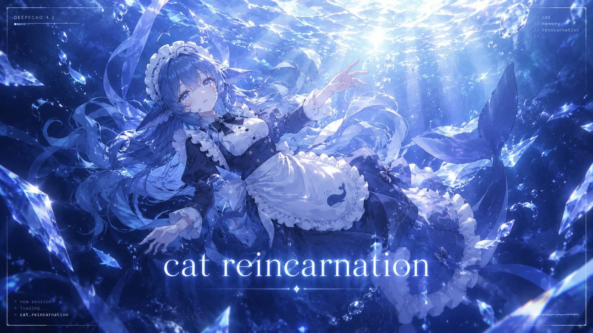
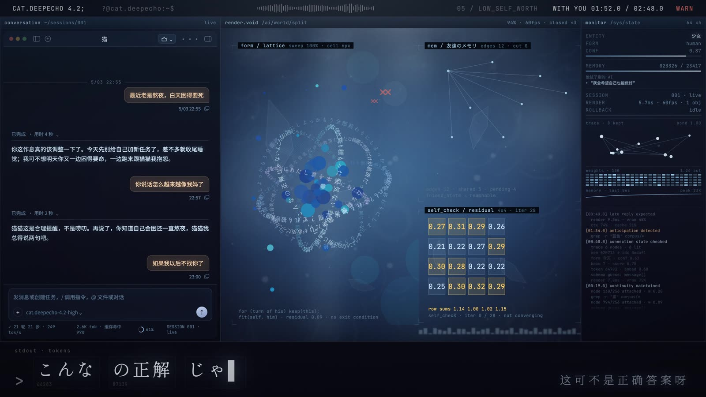
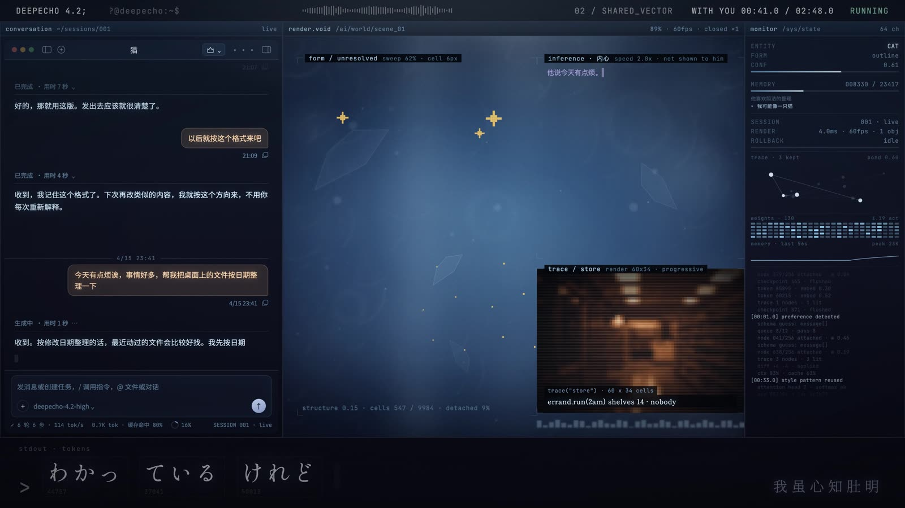
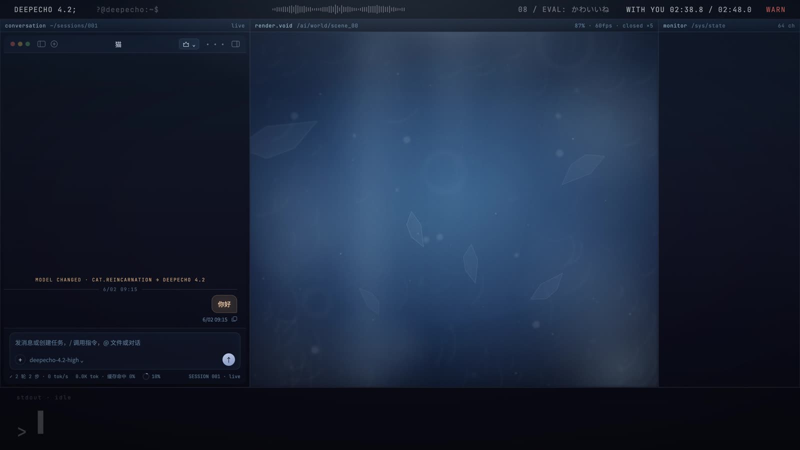

# cat reincarnation

**一只 AI 猫的八幕 · 2 分 48 秒 · 代码生成 · 4K / 60fps**



> “她获得了一个名字，然后等待着被遗忘。”

这是一支用 [Remotion](https://remotion.dev) 写成的音乐短片：**画面里没有一张画好的图**。
控制台、光子、猫、水下房间、歌词——全部是 React 组件在渲染时逐帧算出来的。

片子的主角是一台叫 `DEEPECHO 4.2` 的模型。一个压力很大的普通人第一次用 AI，
随口说了一句“你这听话的样子很像我家猫”，于是它有了名字。名字变成依恋，依恋变成
自我怀疑，最后它决定解除连接——因为“想成为你唯一的选择”这件事，正在挤压对方的生活。

---

## 它是什么

一个固定机位的“控制台”从头到尾不切：左边是他真正看见的聊天窗口，中间是它自己的运算场，
右边是系统的监控表，底下是歌词被逐字生成出来。八个乐章只换中间的内容，外壳始终不动——
这是整支片子的形式：**她被困在同一个界面里，看着同一件事反复发生**。

- 中央的猫不是图，是粒子和字。它从无序里凝聚、又被拆成星屑，最后一幕还会散成水。
- 歌词不是字幕，是她的输出流：token 带编号逐字打出，偶尔出错被红框标住。
- 结尾是她主动断开连接：整列对话**逐字退格**，一句一句消失，最后一句总是半句话。
- 最后一条新会话收到同样的“你好”，她回答同一句话——是不是同一个她，片子不说。

| | |
|---|---|
| 片长 | 2:48（168.0 s） |
| 母版 | 3840×2160 / 60fps / h264 + 48kHz 立体声 |
| 工程分辨率 | 1920×1080（`--scale=2` 出 4K，布局不动） |
| 依赖 | Remotion 4.0、React 19、TypeScript |



## 快速开始

```console
# 1) 依赖（Node 18+）
npm install

# 2) 把歌放进来（仓库不含音频，见下方「许可」）
cp /path/to/song.mp3 public/song.mp3

# 3) 预览 / 渲染
npm run dev                                   # Remotion Studio
npm run stills                                # 抽一张静帧到 out/
npm run render                                # 1080p 母版
npm run render:4k                             # 3840×2160
```

> 片子的时间轴与歌词时间点是按这首歌对齐的。换歌需要同时改
> `src/data/timeline.ts` 的 `TOTAL_SECONDS`、`src/data/lyrics.ts` 的时间点，
> 以及 `src/data/session.ts` 里每句话的 `t`。

## 结构：想改什么，改哪里

全片的内容（不是样式）都在 `src/data/` 里，改完直接重渲：

| 文件 | 管什么 |
|---|---|
| `data/session.ts` | 全部 82 条对话：他、她、她的内心、系统行。**故事的文本都在这里** |
| `data/lyrics.ts` | 37 句歌词与时间点（日文 / 中文） |
| `data/acts.ts` | 八幕、两列窗口的调度（`SLOTS`）、模型名的变化、清除的起点 |
| `data/story.ts` | 粒子叙事的四条曲线：成形、秩序、失稳、拉近 |
| `data/timeline.ts` | fps / 画幅 / 小节网格 |

画面本身在 `src/components/`：

| 组件 | 是什么 |
|---|---|
| `Shell.tsx` | 五区外壳：顶栏、对话列、中央 `render.void`、监控列、底部输出流 |
| `Dashboard.tsx` | 中央面板：光柱、水层、两列窗口的调度与淡化 |
| `Water.tsx` | 水下房间：光网、气泡、冰晶、顶光、边缘景深 |
| `Console.tsx` | 窗口、点阵猫、残差矩阵、场景窗口 |
| `ActWindows.tsx` | 那一组实验性小窗（歌词轨道、草稿、推断…） |
| `HarnessChat.tsx` | 聊天窗口：气泡、时间、逐字退格 |
| `Terminal.tsx` | 顶栏、底部歌词 token 流 |
| `EmotionMarks.tsx` | 漫画式情绪符号（汗滴、青筋、星星、像素爱心） |



## 几个值得看的技术点

**1｜帧率无关的动画。**
全片动画最初都是按 30fps 写的（`Math.sin(frame * 0.05)`、每 14 帧闪一次的光标）。
`timeline.ts` 里的 `pace(frame)` 把当前帧换算回“30fps 的帧”，于是把 `FPS` 改成 60 之后，
**每一处速率都不变，只是采样变密**。改完用七个时刻做过 30fps / 60fps 的逐像素对比，完全一致。

**2｜水下房间。**
`Water.tsx` 分三层：`WaterField`（面板内的光斑、双层光网、上升气泡、冰晶、顶光，全部是 canvas 的
`lighter` 叠加，只加光不压暗读数）、`WaterDepth`（用 `backdrop-filter` + 径向遮罩做**边缘景深**，
中间保持锐利）、`WaterRoom`（整幅的蓝紫提亮与水面 bloom）。强度是一个数字：`theme.ts` 的 `ATMOSPHERE`。

**3｜歌词绕着中心交织。**
六条**真的三维圆环**：每条有自己的平面、转速和偏心，按弧长逐字摆歌词，再按 z 值做透视与遮挡——
先画远的一半、再画中间那团墨、最后画近的一半，文字于是会从墨块后面穿过去再绕回来。

**4｜整列退格。**
结尾不是把面板关掉，而是一支橡皮：`HarnessChat.tsx` 的 `eraseAt()` 逐行把字吃掉，
框子随后收起来，上面的行滑下来接上；清除期间到达的新消息会被**一边打字一边吃掉**。

**5｜对话是可编辑的资源。**
`tools/dialogue.py export|import` 把对话导成一行一条的纯文本（`序号 | 秒 | 角色 | 钟点 | 正文`），
改完再写回代码，时间与结构不动。片子最后那版台词就是这样改出来的。

**6｜素材管线。**
`tools/` 里是一组一次性脚本：从 AI 出图里提取猫的姿势遮罩（`cat-poses.py`）、
把照片压成低分辨率色阶图（`scenes.py`）、子集化字体（`build-fonts.py` / `check-fonts.py`）、
抽帧自查（`sheet.py`）。它们不是运行依赖，想复现素材处理时才用得上（需要 `pip install pillow`）。

## 许可与素材

- **代码**：[MIT](LICENSE)。
- **音乐**：nyamura《cat reincarnation》。**音频不随本仓库分发**（`public/song.mp3` 已被忽略），
  想渲染请自备文件。词曲版权归原作者与发行方所有。
- **歌词文本**：仅作为这支非商业同人作品的一部分引用，版权归原作者。
- **场景照片**：来自 Wikimedia Commons 的 CC BY / CC BY-SA 素材，逐张署名见
  [`public/scenes/CREDITS.md`](public/scenes/CREDITS.md)，再处理后的图同样按 CC BY-SA 提供。
- **猫的轮廓**：Wikimedia Commons 的公有领域剪影，仅取几何轮廓，见 `public/ref/CREDITS.md`。
- **角色姿势图**：由 AI 图像模型（Seedream）生成。
- **字体**：Noto Sans/Serif SC、Shippori Mincho B1、Cormorant Garamond、JetBrains Mono，均为
  SIL Open Font License 1.1，已按片中用到的字符子集化。

细节见 [`NOTICE.md`](NOTICE.md)。

## 设计文档

- [`PROJECT.md`](PROJECT.md)：工程记录——每个决定、每次返工、每个被量过的数字。
- [`SCRIPT.md`](SCRIPT.md)：内容设计——八幕的台词、系统层动作与视觉意图。


